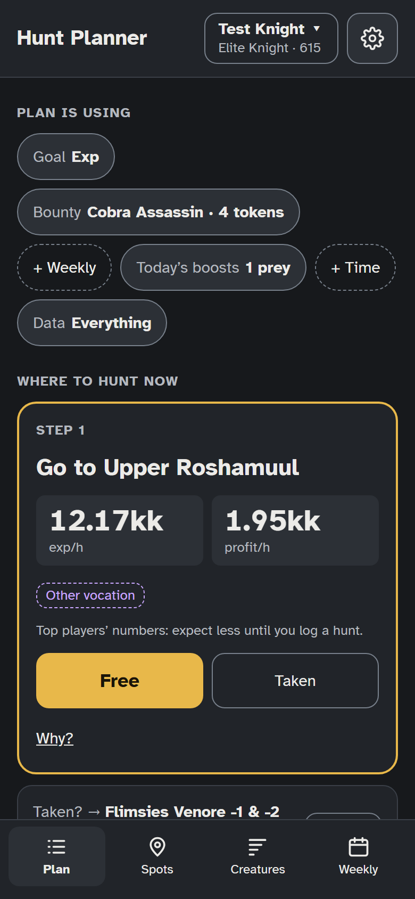
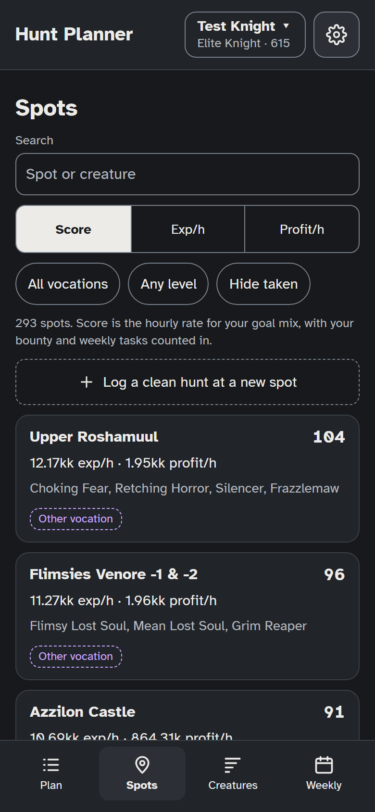
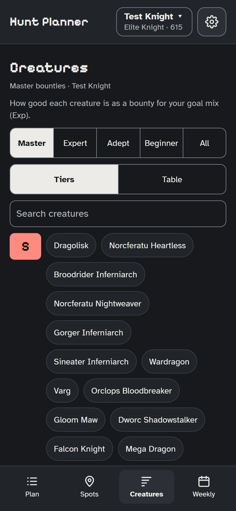

**English** · [Español](README.es.md) · [Português (Brasil)](README.pt-BR.md) · [Polski](README.pl.md)

# Hunt Planner

Where should you hunt right now? Hunt Planner answers that for Tibia players, around the Bounty Task board: enter your three bounty offers (or the one you picked), and it gives you a short plan: go to this spot, for this offer; taken? try that one; else reroll. It weighs your bounty, your weekly kill tasks, today’s boosted creature and prey, and what you hunt for (exp, profit, charm points or bounty points). It used to be called the Bounty Task tier list.

**Open it: https://anthonygdi2.github.io/hunt-planner/** (install it from your browser, “Install app” or “Add to Home screen”, to use it offline).

  
  
  

## What it does

- **Plan**: the steps for right now, each with Free and Taken (spots marked taken are skipped for a while), and a “Why?” under each.
- **Spots**: every hunting spot that fits your vocation and level, scored for your goal, with where the numbers come from.
- **Creatures**: every bounty creature ranked S to D for your goal, your Preferred and Unwanted lists with the odds they give you, and each creature’s spots, bestiary and notes.
- **Weekly**: your weekly kill tasks, so spots with open tasks score higher, and which weekly difficulty pays the most exp at your level.
- **Log a clean hunt**: paste Tibia’s Hunting Session Analyser text, and that spot’s numbers become your own. Published reference hunts fill in until then, and they’re adjusted to you once you’ve logged a few.

## Languages

English, Español, Português (Brasil) and Polski: the app picks your browser’s language the first time, and you can change it on the first screen or in Characters and settings. The translations are new, so if something reads wrong, [open an issue](https://github.com/anthonygdi2/hunt-planner/issues). Creature and spot names stay as Tibia shows them. This README is also in [Español](README.es.md), [Português (Brasil)](README.pt-BR.md) and [Polski](README.pl.md); those cover using the app, and this English one stays the full reference.

## Your data

Everything you enter stays in your own browser: there’s no account and no server. Use **Characters and settings → Download backup** to keep a copy or move it to another device. A backup holds your characters and hunts, so don’t post it publicly (for example in an issue).

## Where the numbers come from

- Creature data, creature exp and today’s bonus rules: [TibiaWiki](https://tibia.fandom.com/wiki/Task_Board), under CC BY-SA.
- Reference hunts: read from [Kusnier’s hunt videos](https://www.youtube.com/@Kusnierr/videos) (also listed on [TibiaPal](https://tibiapal.com)), each with a link to its video.
- Game rules (task rewards, bounty points, bestiary, weekly rewards) are in [`src/data/rules.js`](src/data/rules.js), each with its source; how sure each one is, is in [`docs/PROJECT_CONTEXT.md`](docs/PROJECT_CONTEXT.md).
- Font: Atkinson Hyperlegible, under the SIL Open Font License (`fonts-OFL.txt`).

Licenses for each data file are in [`src/data/README.md`](src/data/README.md).

Tibia is a trademark of CipSoft GmbH. Hunt Planner is a fan project and isn’t affiliated with or endorsed by CipSoft.

## Problems and ideas

[Open an issue](https://github.com/anthonygdi2/hunt-planner/issues): what you did, what you expected, and what happened (a screenshot helps). To help with the code or the data, see [CONTRIBUTING.md](CONTRIBUTING.md).

## License

The code is under the [MIT License](LICENSE): anyone may use, change and share it. The data files keep their own licenses: the TibiaWiki-derived creature data is CC BY-SA, and the reference hunts come from Kusnier’s videos (see [`src/data/README.md`](src/data/README.md)). The font is under the SIL Open Font License.
